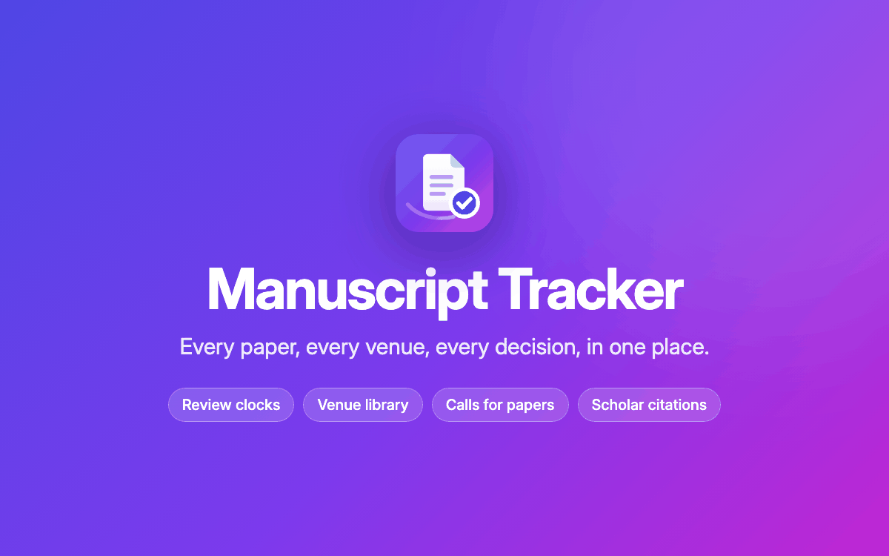
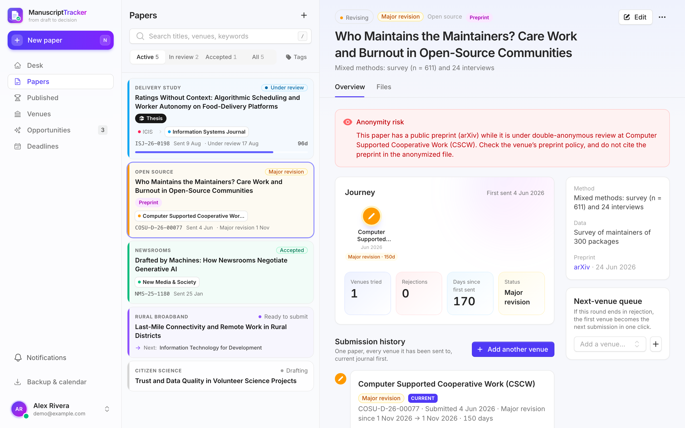
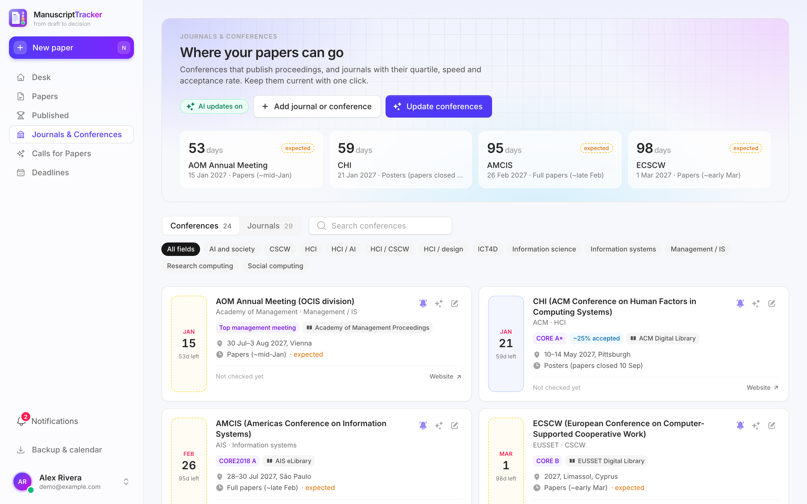
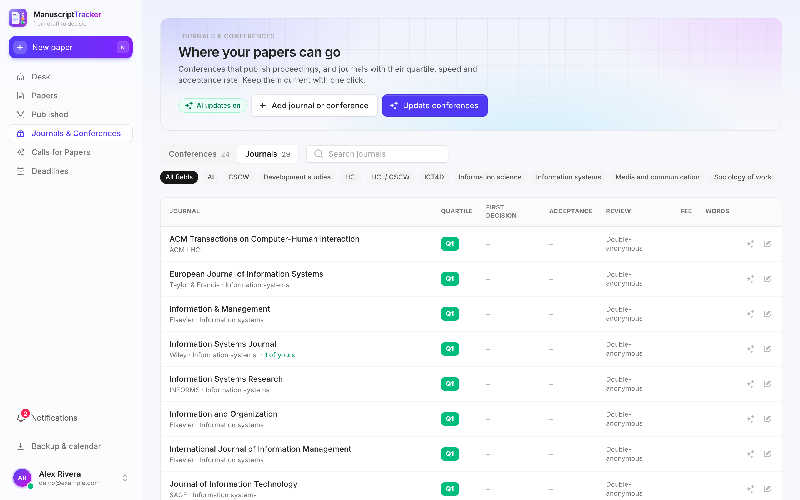
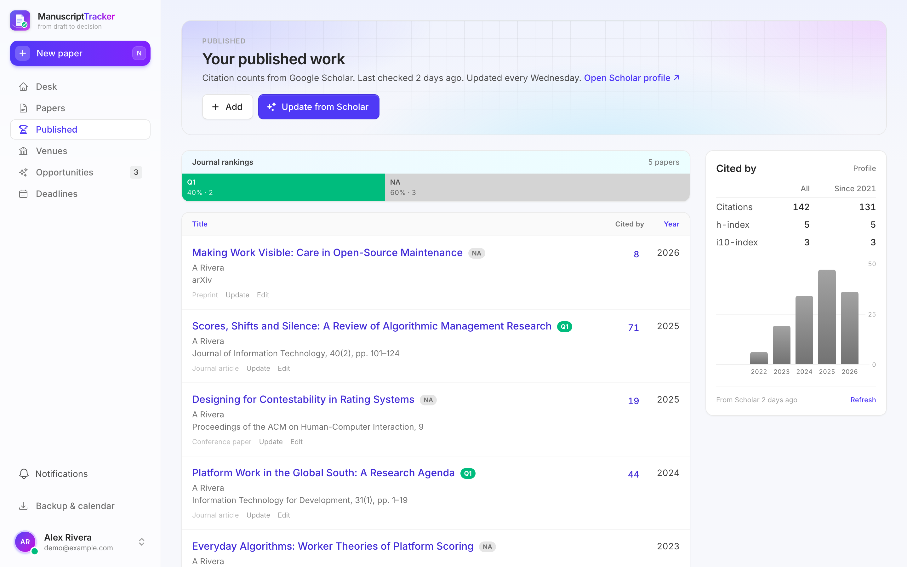
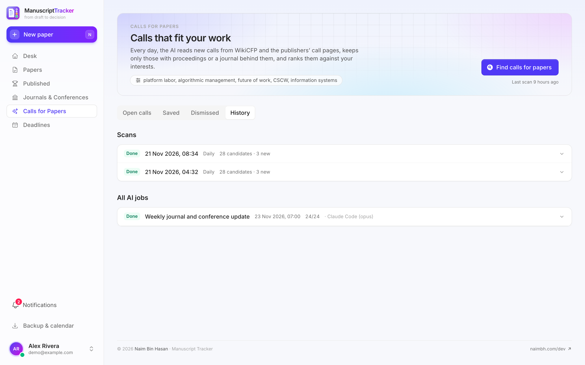

# Manuscript Tracker: a self-hosted manuscript and journal submission tracker

**An academic paper tracker for researchers and PhD students, from draft to decision.**

Track every manuscript through every journal and conference it is sent to, follow its peer review status and editor decisions, watch review clocks and revision deadlines, keep your journals and conferences up to date with AI, find calls for papers that fit your work, and see your Google Scholar citations in one place. Self-hosted, so your data stays in your own database.

## Prefer a desktop app?

Manuscript Tracker is also available as a **free, open-source desktop app for macOS, Windows and Linux**: [naimbh/manuscript-tracker-desktop](https://github.com/naimbh/manuscript-tracker-desktop). It needs no server, works fully offline, and uses AI only if you choose to.

Your data moves both ways. In either app, open **Backup & calendar → Download backup (.zip)**, then use **Import** in the other app.

  

## Why a manuscript tracker instead of a spreadsheet?

Most researchers track submissions in a spreadsheet. A spreadsheet cannot tell you that a review has run past the journal's usual decision time, that a public preprint may break a double-anonymous review, or which journal to try next after a desk rejection. Manuscript Tracker knows what a manuscript ID, a desk rejection, a review clock and a preprint policy are, and it keeps your data in your own database.

## Features for tracking papers, submissions and peer review

**Papers and submissions**
- One record per paper with abstract, keywords, method, data, links, tags (such as *Thesis* or *Preprint*) and notes.
- A full submission history per paper: every journal or conference, manuscript ID, portal link, dates and decision. Mark one as the current journal.
- A **journey** view of every journal or conference a paper has been sent to, with days in review and the outcome of each round.
- **Review clocks** that compare days in review with the usual decision time of each journal or conference and flag overdue reviews.
- A **next-submission queue**: after a rejection, submit to the next journal in one click.
- A **reviewer-comment checklist**: paste the reviews, tick off each point and write your response.
- Authors with ORCID and **CRediT roles**, and a contribution statement you can copy.
- Optional uploads for manuscripts, cover letters, responses and the **publisher's proof PDF**, with an in-app PDF preview.
- A warning when a paper under double-anonymous review has a public preprint.

**Journals & Conferences**
- A starter library of IS, iSchool and HCI **conferences that publish proceedings** (CHI, CSCW, ICIS, ECIS, HICSS, AMCIS, iConference, ASIS&T and more) and **journals** with quartile, time to first decision, acceptance rate, fees and review type.
- **AI updates**: one click (or a weekly schedule) checks the official pages of each journal and conference for the next edition, the deadline and current details, and saves the sources it used.

**Calls for Papers**
- A **daily scan** for calls for papers, special issues and archival tracks that fit your interests. It reads WikiCFP feeds, then the AI checks each call on its official page and ranks it by fit.
- A **history** of every scan and AI job, with its provider, timing, step-by-step log and any errors.
- Weekly lists, **Find calls for papers**, save, dismiss, or add the deadline to your calendar.

**Published work**
- Your publications in a Google Scholar style list, with the **Cited by** table (citations, h-index, i10-index), a citations-per-year chart and journal rankings.
- Connect your own Scholar profile under **Settings → Research profile**; counts are refreshed every week, or on demand.

**Everyday use**
- A Desk page with what needs attention, upcoming deadlines, review clocks and a twelve-month timeline.
- Deadlines with countdowns and a **calendar feed (.ics)** for Google Calendar, Apple Calendar or Outlook.
- Notifications and a live progress panel for long AI jobs, with optional desktop notifications.
- **Agent tools (MCP)**: let Claude Desktop, Claude Code, Cursor or any MCP client read your papers and record submissions, decisions and deadlines.
- JSON export and import, light and dark themes, and keyboard shortcuts (<kbd>N</kbd> new paper, <kbd>/</kbd> search).

## Screenshots

| Desk | Revising, with the reviewer checklist |
|---|---|
|  |  |
| **Conference library** | **Journal library** |
|  |  |
| **Published work and citations** | **Calls for Papers** |
|  |  |
| **Scan and AI job history** | **AI settings: choose your provider** |
|  |  |

Screenshots use the fictional demo data that ships with the app. A dark theme is also included.

## AI features

The calls for papers scan, journal and conference updates, and citation updates use an AI model that can search the web. You can choose Claude (Claude Code or the Anthropic API), OpenAI, Google Gemini, or any OpenAI-compatible provider under **Settings → AI**. The AI is asked to use official pages, to return `null` rather than guess, and to list its sources, which the app shows next to each journal and conference.

Manuscript Tracker also includes **agent tools (MCP)**, so Claude Desktop, Claude Code, Cursor or any MCP client can read your papers and record submissions, decisions and deadlines.

See [Installation and setup](docs/INSTALLATION.md#ai-features) for providers, keys and MCP setup.

## Your data

Everything lives in your own database and `storage/app`. Under **Settings → Backup & calendar**, download a backup (a .zip with your files, or data only as .json) or import one; the same backups work in the desktop app. Uploaded files are private and served only to their owner.

## Support the project

If Manuscript Tracker saves you time, please give it a ⭐ on GitHub. It helps other researchers find it. Bug reports, ideas and pull requests are welcome in [Issues](https://github.com/naimbh/manuscript-tracker/issues).

## License

[PolyForm Noncommercial 1.0.0](LICENSE) © 2026 [Naim Bin Hasan](https://naimbh.com/dev)

You may use, change and share this software for any **noncommercial** purpose: personal use, research, teaching, and use by universities, charities and other noncommercial organizations. Commercial use, including selling it, offering it as a paid service or using it inside a business, is not allowed without permission. For a commercial license, get in touch through [naimbh.com/dev](https://naimbh.com/dev).

## Install and develop

  
  

- [Installation and setup](docs/INSTALLATION.md): tech stack, local install, demo data, AI providers, agent tools (MCP), shared hosting (cPanel), schedules and configuration.
- [Development](docs/DEVELOPMENT.md): running the tests and rebuilding the front end.
