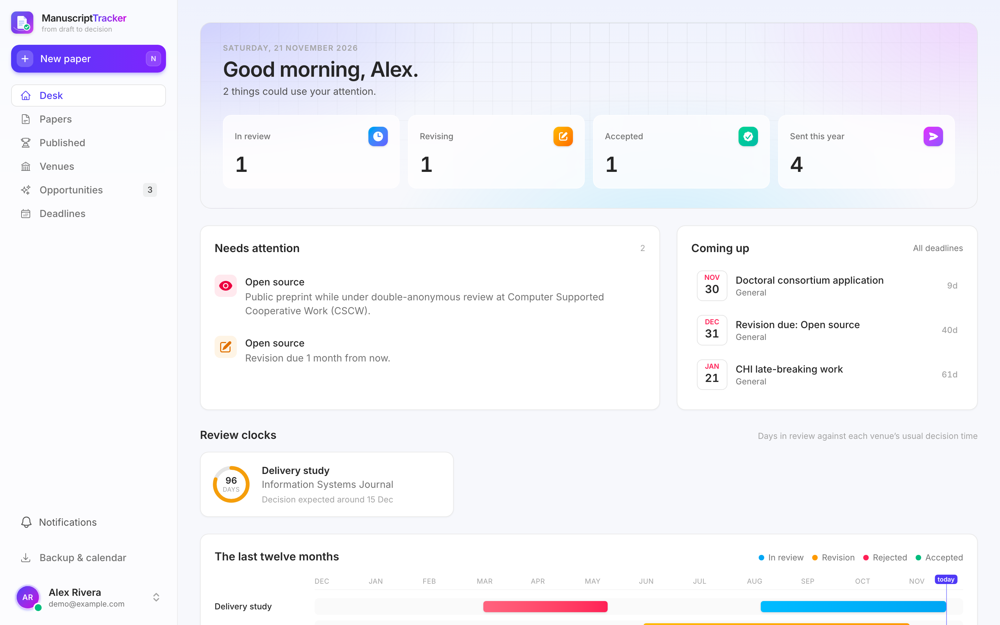
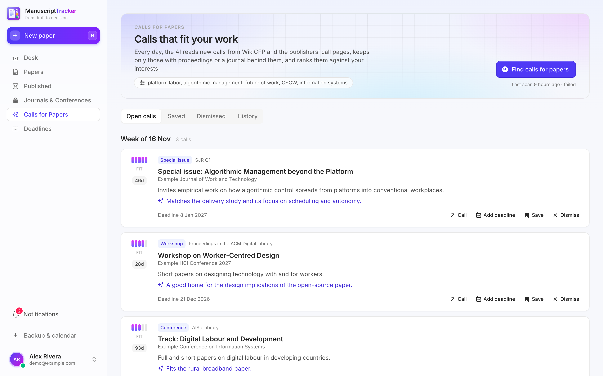
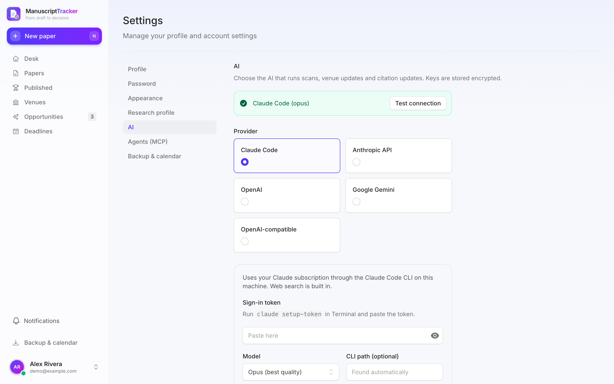

<div align="center">


# Manuscript Tracker

**A self-hosted tracker for academic papers, from draft to decision.**

Follow every manuscript through every journal and conference it is sent to, watch review clocks, keep your journals and conferences up to date with AI, find calls for papers that fit your work, and see your Google Scholar citations in one place.

[](https://laravel.com)
[](https://livewire.laravel.com)
[](https://www.php.net)
[](https://www.mysql.com)
[](https://tailwindcss.com)
[](LICENSE)

</div>


## Why

Most researchers track submissions in a spreadsheet. A spreadsheet cannot tell you that a review has run past the journal's usual decision time, that a public preprint may break a double-anonymous review, or which journal to try next after a desk rejection. Manuscript Tracker knows what a manuscript ID, a desk rejection, a review clock and a preprint policy are, and it keeps your data in your own database.

## Features

**Papers and submissions**
- One record per paper with abstract, keywords, method, data, links, tags (such as *Thesis* or *Preprint*) and notes.
- A full submission history per paper: every journal or conference, manuscript ID, portal link, dates and decision. Mark one as the current journal.
- A **journey** view of every journal or conference a paper has been sent to, with days in review and the outcome of each round.
- **Review clocks** that compare days in review with the usual decision time of each journal or conference and flag overdue reviews.
- A **next-submission queue**: after a rejection, submit to the next journal in one click.
- A **reviewer-comment checklist**: paste the reviews, tick off each point and write your response.
- Authors with ORCID and **CRediT roles**, and a contribution statement you can copy.
- Optional uploads for manuscripts, cover letters, responses and the **publisher's proof PDF**, with an in-app PDF preview.
- A warning when a paper under double-anonymous review has a public preprint.

**Journals & Conferences**
- A starter library of IS, iSchool and HCI **conferences that publish proceedings** (CHI, CSCW, ICIS, ECIS, HICSS, AMCIS, iConference, ASIS&T and more) and **journals** with quartile, time to first decision, acceptance rate, fees and review type.
- **AI updates**: one click (or a weekly schedule) checks the official pages of each journal and conference for the next edition, the deadline and current details, and saves the sources it used.

**Calls for Papers**
- A **daily scan** for calls for papers, special issues and archival tracks that fit your interests. It reads WikiCFP feeds, then the AI checks each call on its official page and ranks it by fit.
- A **history** of every scan and AI job, with its provider, timing, step-by-step log and any errors.
- Weekly lists, **Find calls for papers**, save, dismiss, or add the deadline to your calendar.

**Published work**
- Your publications in a Google Scholar style list, with the **Cited by** table (citations, h-index, i10-index), a citations-per-year chart and journal rankings.
- Connect your own Scholar profile under **Settings → Research profile**; counts are refreshed every week, or on demand.

**Everyday use**
- A Desk page with what needs attention, upcoming deadlines, review clocks and a twelve-month timeline.
- Deadlines with countdowns and a **calendar feed (.ics)** for Google Calendar, Apple Calendar or Outlook.
- Notifications and a live progress panel for long AI jobs, with optional desktop notifications.
- **Agent tools (MCP)**: let Claude Desktop, Claude Code, Cursor or any MCP client read your papers and record submissions, decisions and deadlines.
- JSON export and import, light and dark themes, and keyboard shortcuts (<kbd>N</kbd> new paper, <kbd>/</kbd> search).

## Screenshots

| Desk | Revising, with the reviewer checklist |
|---|---|
|  |  |
| **Conference library** | **Journal library** |
|  |  |
| **Published work and citations** | **Calls for Papers** |
|  |  |
| **Scan and AI job history** | **AI settings: choose your provider** |
|  |  |

Screenshots use the fictional demo data that ships with the app. A dark theme is also included.

## Tech stack

- [Laravel 12](https://laravel.com) with [Livewire](https://livewire.laravel.com), [Volt](https://livewire.laravel.com/docs/volt) and [Flux UI](https://fluxui.dev)
- [Tailwind CSS 4](https://tailwindcss.com) and [Alpine.js](https://alpinejs.dev)
- MySQL (SQLite also works)
- Your choice of AI for the research features: Claude (Claude Code CLI or Anthropic API), OpenAI, Google Gemini, or any OpenAI-compatible provider
- [Laravel MCP](https://laravel.com/docs/mcp) for the agent tools

## Getting started

Requirements: PHP 8.2+, Composer, Node.js 20+ and MySQL 8 (or SQLite). [Laravel Herd](https://herd.laravel.com) is the quickest way to get all of them on macOS or Windows.

```bash
git clone https://github.com/naimbh/manuscript-tracker.git
cd manuscript-tracker
composer install
npm install && npm run build
cp .env.example .env
php artisan key:generate
```

Create a database, set `DB_CONNECTION`, `DB_DATABASE`, `DB_USERNAME` and `DB_PASSWORD` in `.env`, then:

```bash
php artisan migrate --seed
php artisan storage:link
```

Open the app (for example `http://manuscripttracker.test` with Herd, or run `php artisan serve`) and sign in with the first account, **admin@gmail.com / 123456** unless you set `TRACKER_ADMIN_EMAIL` and `TRACKER_ADMIN_PASSWORD` in `.env` before seeding. Change the email and password under **Settings → Profile** straight away. Other people can register from the login page; each account starts with the starter list of journals and conferences and keeps its own papers.

Then open **Settings → Research profile** to add your Google Scholar link and research interests, and **Settings → AI** to choose an AI provider.

### Try it with demo data

```bash
php artisan db:seed --class=DemoSeeder
```

Then sign in as **demo@example.com / password**.

## AI features

The calls for papers scan, journal and conference updates, and citation updates need an AI model that can search the web. Choose one under **Settings → AI**, paste its key, and press **Test connection**:

| Provider | What you need | Web search |
|---|---|---|
| Claude Code | A Claude subscription and [Claude Code](https://docs.claude.com/en/docs/claude-code). Run `claude setup-token` and paste the token. | Built in |
| Anthropic API | An API key from the [Claude Console](https://console.anthropic.com) | Claude web search tool |
| OpenAI | An API key from [platform.openai.com](https://platform.openai.com) | Responses API web search |
| Google Gemini | A key from [Google AI Studio](https://aistudio.google.com) | Google Search grounding |
| OpenAI-compatible | A base URL, model and (if needed) key for OpenRouter, Groq, Perplexity, Together, Ollama or LM Studio | Depends on the model (for example OpenRouter `:online` models or Perplexity Sonar) |

Keys are stored encrypted with your app key. You can also set them in `.env` (see `.env.example`); values saved in Settings take priority.

The AI is asked to use official pages, to return `null` rather than guess, and to list its sources, which the app shows next to each journal and conference. Check important dates on the official site before you rely on them.

## Agent tools (MCP)

Manuscript Tracker includes a [Model Context Protocol](https://modelcontextprotocol.io) server, so AI assistants can work with your tracker. Tools: `list-papers`, `get-paper`, `add-paper`, `update-paper`, `record-submission`, `update-submission`, `record-decision`, `attach-file` (local server only), `list-deadlines`, `add-deadline`, `search-venues`, `list-opportunities` and `list-publications`.

**On the same computer** (Claude Desktop, Claude Code, Cursor): add a server that runs

```bash
php /path/to/manuscript-tracker/artisan mcp:start tracker
```

Settings → Agents shows the exact config to copy. The local server acts for the account in `TRACKER_MCP_USER`, or the first account.

**Over the web**: create an agent token under **Settings → Agents** and connect your client to `https://your-domain/mcp` with the header `Authorization: Bearer <token>`.

## Deploying to shared hosting (cPanel)

1. Clone the repo with cPanel → Git Version Control, outside `public_html`.
2. Run `composer install --no-dev --optimize-autoloader`, copy `.env.example` to `.env`, set `APP_ENV=production`, `APP_DEBUG=false`, `APP_URL` and the database, then `php artisan key:generate --force` and `php artisan migrate --force`.
3. The built front end (`public/build`) is committed, so the server does not need Node.js. If you change the CSS or JavaScript, run `git config core.hooksPath .githooks` once; the pre-commit hook then rebuilds and commits `public/build` for you.
4. Point the domain's document root at `public/`. If you cannot, the root `.htaccess` sends every request into `public/`.
5. Add a cron job: `* * * * * cd /path/to/manuscript-tracker && php artisan schedule:run >> /dev/null 2>&1`.

## Schedules

| Job | When |
|---|---|
| Calls for papers scan | Every day at 6:00 (`TRACKER_SCAN_TIME`) |
| Journal and conference updates (watched ones) | Mondays at 7:00 (`TRACKER_VENUES_DAY`, `TRACKER_VENUES_TIME`) |
| Citation updates from Google Scholar | Wednesdays at 7:00 (`TRACKER_CITATIONS_DAY`, `TRACKER_CITATIONS_TIME`) |

Run the scheduler with `php artisan schedule:work`, or add the usual cron entry on a server:

```cron
* * * * * cd /path/to/manuscript-tracker && php artisan schedule:run >> /dev/null 2>&1
```

## Your data

Everything lives in your own database and `storage/app`. Export a JSON backup or import one under **Settings → Backup & calendar**. Uploaded files are private and served only to their owner.

To seed your own papers without committing them, put a seeder in `database/seeders/Private/` (git ignores that folder). `DatabaseSeeder` runs `Private\MyPapersSeeder` and `Private\MyPublicationsSeeder` if they exist.

## Configuration

The first account is the site admin. Under **Settings → General** the admin sets the site name, tagline, description, timezone, contact email, footer credit, and whether new people can sign up (turn this off for a private site).

Everything specific to a person or a deployment is set in `.env` or in Settings, not in the code: the first account (`TRACKER_ADMIN_*`), schedules (`TRACKER_*_DAY`, `TRACKER_*_TIME`), the AI provider and keys, the MCP account (`TRACKER_MCP_USER`), and the footer credit (`TRACKER_CREDIT_NAME`, `TRACKER_CREDIT_URL`; leave empty to hide). Each user sets their own Scholar profile and interests.

## Tests

```bash
php artisan test
```

## Support the project

If Manuscript Tracker saves you time, please give it a ⭐ on GitHub. It helps other researchers find it. Bug reports, ideas and pull requests are welcome in [Issues](https://github.com/naimbh/manuscript-tracker/issues).

## License

[PolyForm Noncommercial 1.0.0](LICENSE) © 2026 [Naim Bin Hasan](https://naimbh.com/dev)

You may use, change and share this software for any **noncommercial** purpose: personal use, research, teaching, and use by universities, charities and other noncommercial organizations. Commercial use, including selling it, offering it as a paid service or using it inside a business, is not allowed without permission. For a commercial license, get in touch through [naimbh.com/dev](https://naimbh.com/dev).
